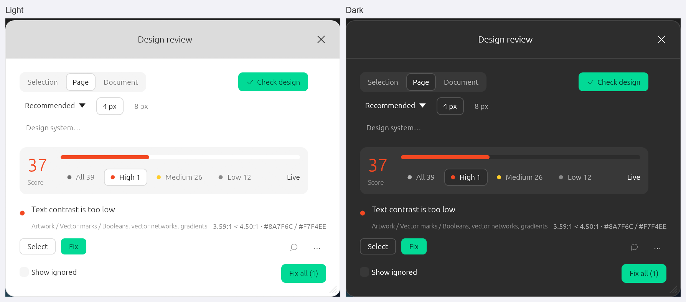

# Design review

FigCraft's deterministic review of a design against the usual AI-generated UI tells. It reads a
selection, a page or the document and reports what a designer would fix first; `design.fix`
repairs the unambiguous findings as one undo step. There is no model, no network and no image
generation: this is a checklist with arithmetic, not a taste engine.

## Commands

| Command | What it does |
|---|---|
| `design.audit {scope?, ids?, rules?, minSeverity?, preset?, modes?}` | Reads the selection (default when something is selected), the page (default otherwise) or the document, or just `ids`. Returns `preset`, `grid`, the modes it read (when `modes` was given), `score`, `counts`, `byRule`, `nodes` and `findings`; every finding has `rule`, `severity`, `node`, `path`, `message`, `fixable` and a `suggestion` where a safe one exists. `details` is present when the finding has measured values behind the message (the window's localized line and agents read them); some findings, such as gradient text, have none. Changes nothing. |
| `design.fix {scope?, ids?, rules?, preset?, exact?, dryRun?}` | Repairs the findings marked fixable in one undo step and reports `changed`, `skipped`, `byRule` and the counts before and after. `dryRun` reports without changing. `exact` (with `ids`) repairs only findings on those layers, not on their descendants. Content, naming and gradients are left alone. The window uses `ids` and `exact` so it repairs only the findings the user kept. |
| `design.assert {scope?, ids?, rules?, preset?, modes?, failOn?, minScore?}` | A read-only gate for CI. It fails with an error that names the counts when a finding at or above `failOn` (default `high`) exists or the score is below `minScore` (default 0); otherwise it returns `{ok: true, score, counts}`. The score covers the whole review, not just the findings at `failOn`. |
| `design.configure {preset?, grid?, radii?, brand?, disabled?, reset?}` | Sets the file's design review settings in one undo step: the preset, the spacing grid, the accepted corner radii, the brand accent colours and the rules this file turns off. `reset: true` returns to the defaults (recommended, 4px grid, 4px radius scale, no brand, no disabled rules). `audit`, `fix` and `assert` use the settings from then on. |
| `design.rules` | Lists the rules with their severity, fixability, the presets that check them and a one-line description, and the presets themselves. |

`scope` is `selection`, `page` or `document`; `ids` names the layers directly (it wins over
`scope`); `rules` narrows the run to rule ids; `minSeverity` is `low`, `medium` or `high`;
`preset` overrides the file's preset for that call; `modes` (`{"Theme": "Dark"}`) resolves
variable-bound colours in those modes for that call.

## Presets and the design system

The review follows the file, not one person's taste. `design.configure` keeps four settings in the
document, so everyone who opens it (and every agent, CLI and CI run) checks against the same
system:

- **Preset.** `recommended` (the default) checks the 26 usual tells. `strict` adds
  `color.accents` (more than two accent colours in one scope) and `layout.no-auto-layout` (a frame
  or component with three or more children and no auto layout). `accessibility` checks only what
  keeps a design usable: contrast, the 11px type floor, gradient text and clipped text.
- **Grid.** 4px by default; 8px (or anything from 1 to 64) makes spacing and radii snap to that
  step instead. The audit's message and the fixer both use it.
- **Radii.** Empty by default, which accepts any multiple of the grid from the grid up, or a pill.
  A list such as `[0, 6, 10, 14]` is the scale then (a pill is still accepted), and the fixer moves
  an off-scale corner to the nearest listed one.
- **Brand.** A list of accent colours the file owns. `color.accents` (Strict) does not count them
  as stray accents. Colours within a few 8-bit steps of a brand colour count as that brand.
- **Disabled.** Rule ids this file turns off: neither reported nor repaired.

The window has the preset and the grid (4 px / 8 px) in its second row; changing either writes the
file with `design.configure` and re-runs the check. Radii, brand colours and disabled rules are
command settings, so a design system can set them once and a CI script can rely on them.

### Variable modes

A layer's colours may come from variables that change per mode. The window and a plain `audit` read
the colours as the file shows them (each layer's own modes, the collections' defaults otherwise).
`modes` overrides that for one run: `{"Theme": "Dark"}` resolves every bound colour in `Theme`'s
Dark mode, for the contrast check, and the report says which modes it read. A finding found that
way is report-only: changing a layer would drift from the design system, so `design.fix` leaves it
alone. To gate both appearances, run the gate twice:

```sh
echo '[{"command":"design.assert","params":{"scope":"page","modes":{"Theme":"Light"},"failOn":"high"}},{"command":"design.assert","params":{"scope":"page","modes":{"Theme":"Dark"},"failOn":"high"}}]' > review.jsonl
figcraft-cli run review.jsonl --in design.figcraft
```

The same commands are available through the CLI (`figcraft-cli run`), the control channel and MCP
(`run_command`). The MCP server's initialize instructions name them, and `prompts/list` has the
`design_review` prompt: it reads the screen and writes a five-line direction, runs the audit and
`design.fix` for the mechanical findings, then uses judgment for copy, naming, gradients and text
overflow (the things arithmetic cannot decide), audits again and reports what it fixed each way and
what it left. `VERIFY` in the design prompts runs the audit before an agent finishes a screen.

A CI gate is a one-step script, since `figcraft-cli run` exits 1 when a step fails:

```sh
echo '[{"command":"design.assert","params":{"scope":"page","failOn":"medium","minScore":70}}]' > review.jsonl
figcraft-cli run review.jsonl --in design.figcraft
```

## The window

The checkmark button in the bottom toolbar — **Review design**, next to Actions — opens a movable,
resizable window, as do **Review design** in the Actions palette (⌘K, no search needed) and
`ui.menu.invoke {"id": "design.audit"}` on the control channel. Pick Selection, Page or Document
and press **Check design**. The score sits in a summary card with its bar; the severity counts are
chips that also filter the list. Each finding is a row with its rule, layer path, localized values
and a filled **Fix** when the review can repair it; a finding the review will not touch shows
**Report only** with the reason on hover — the value belongs to a variable or style (fix the
variable or unbind first), it was read in the variable modes you chose, or it needs a decision
(content, naming or gradients). The row under the scope picks the file's **Preset** and its
**Grid** (4 px or 8 px), and **Design system…** unfolds the rest of the file's settings: the
accepted **Radii** (empty: grid steps and pills) and **Brand colours** as comma-separated fields,
and the **Disabled rules** as checkboxes. Everything there writes the file with `design.configure`
and checks again, so the next person, agent and CI run read the same system. **Select** selects
the layer; **Fix** applies that rule; **Fix all** applies every fixable rule; **Comment** pins the
finding to its layer as a comment, so the comments panel and the `fix_comments` / `watch_comments`
loop can pick it up. **Live** re-runs the check after an edit has been still for a moment.
**Ignore** hides one finding, **Ignore all of this rule** hides the rule, and **Show ignored** /
**Clear ignores** bring them back. Ignores belong to the file: they are saved in the preferences
by document path, so reopening a saved file keeps them (an unsaved file keeps them for the session
only). The **…** menu also has **Select all** for every layer behind that rule. Repairs run
`design.fix` with the visible layers as `ids`, so an ignored finding is left alone, and the list
checks itself again. The toolbar button closes the window again when it is open.



The window follows Preferences ▸ Language: its labels, severity names and rule titles are in the
interface catalogs (all 24, Chinese included; the regional Spanish overlay reads Spanish). Each
finding shows its values on a line built for the interface language from the finding's `details` —
field names come from the catalogs in every language ("Gap 13", "Padding 11 11 12 12"), while
numbers, colours, layer names and mode names stay as they are. The engine's `message` and `path`
stay English, like command and MCP output; the window shows the localized line instead of the
message, and the rule id is on the label's tooltip for use with `rules`. Agents get the same values
structurally in `details`. A finding the review will not repair carries `reason`: `"bound"` (the
value belongs to a variable or style), `"modes"` (read in the chosen variable modes) or `"decision"`
(needs a judgment call) — the same text the window's **Report only** chip explains.

## Prior art

The interaction model follows open-source design linters rather than inventing one:

- *Design Lint* ([destefanis/design-lint](https://github.com/destefanis/design-lint)) — live
  re-lint, click-to-select, Ignore / Ignore All, Select All, locked layers skipped, configurable
  radii.
- *@shadcn/lint* ([shadcn-ui/lint](https://github.com/shadcn-ui/lint)) — agent-first diagnostics
  that explain the allowed alternative, with configurable rules and component contracts.
- *figma-use* linter ([dannote/figma-use](https://github.com/dannote/figma-use)) — rule categories,
  presets, JSON/CI output.

The review borrows the interaction model (click-to-select, severity filter, Fix all, Comment, live
re-lint, persisted ignores, Select all), the CI idea (`design.assert`) and the per-file settings
(`design.configure`: preset, grid, radii, brand, disabled rules) from these projects. No code,
text or asset is copied; the rules are FigCraft's own.

## What it checks

| Rule | Severity | Fixable |
|---|---|---|
| `spacing.off-grid` — gap or padding off the 4px grid | medium | yes |
| `radius.off-scale` — a corner not on the 4px scale or a pill | low | yes |
| `type.sizes` — more than five sizes in one scope | medium | no |
| `type.families` — more than two families in one scope | medium | no |
| `type.weight` — a heading heavier than 600 | low | yes |
| `type.italic` — italic interface text | low | yes |
| `type.too-small` — body text below 11px | medium | no |
| `type.negative-tracking` — small text tracked tighter | low | yes |
| `color.gradient` — a shape painted with a gradient | medium | no |
| `color.gradient-text` — text painted with a gradient | high | no |
| `color.glow` — a shadow with no offset and a large blur | medium | yes |
| `color.colored-shadow` — a shadow with a visible hue | low | yes |
| `color.border-opacity` — a border stronger than a hairline (container shapes; an icon's own stroke is exempt) | low | yes |
| `color.contrast` — text below 4.5:1 (3:1 large) | high | yes |
| `color.accents` — more than two accent colours in one scope, brand colours excluded (**Strict**) | medium | no |
| `token.hardcoded-color` — a solid colour equals a colour variable but is not bound | low | no |
| `token.hardcoded-number` — spacing, radii, a text size or opacity equals a number variable but is not bound | low | no |
| `icon.emoji` — emoji in text or a layer name | low | no |
| `copy.exclamation` — an exclamation mark in interface copy | low | no |
| `copy.trailing-period` — a short label ending in a period | low | no |
| `copy.hype` — "AI-powered", "supercharge" and the like | low | no |
| `naming.auto` — a layer still named "Frame 12" | low | no |
| `detail.shadow-count` — shadows on too many layers | low | no |
| `layout.text-overflow` — a fixed-width text box shorter than its text | high | no |
| `layout.clipped` — a fixed-size auto-layout frame clipping children that overflow it, so they are invisible | high | no |
| `layout.no-auto-layout` — a frame or component with three or more children and no auto layout (**Strict**) | low | no |

The pair to remember: **hi**gh is a blocker (contrast, gradient text, clipped text), **medium** is
a discipline problem (spacing, type, gradients), **low** is polish (weights, borders, names, copy).
A clean screen has no high and at most two medium findings.

## Design-system values

Locked layers are left out. A value bound to a variable, or a layer linked to a text, paint, stroke
or effect style, is reported but not auto-fixed (its finding says so): fix the variable or style,
or unbind first. `design.fix` skips those fields too, so a review never quietly breaks a token.
The report carries `byRule` counts, so an agent can group the work. A finding can also become a
comment with the window's **Comment** button: it is pinned to the layer and enters the normal
comments workflow. The token rules go the other way: a hardcoded value that exactly matches a
variable's default-mode value is reported so it can be bound (layers with explicit variable modes
are left to the variables).

## What it deliberately does not do

- **No direction, copywriting or composition.** Choosing what a product should feel like, rewriting
  a headline or inventing a hero visual needs a model (or a person); the audit can only report what
  is measurable. For that layer use the MCP agent loop with `design_review`, or a person.
- **Gradients, naming and copy are report-only.** They need a decision, not a formula.
- **Contrast is only judged on a known opaque solid backdrop.** A gradient, image, translucent layer
  or partial cover makes it skip the check rather than guess. Backgrounds are found through the
  paint order (siblings below the text, groups and containers included, `reverse_z` respected).
- **Text overflow is measured with the text layout engine.** A font that lays out differently than
  it renders can still clip; the screenshot is the last word.
- **A backdrop lookup is bounded.** It scans at most 512 siblings or children at a level; a
  background deeper in a giant flat frame is treated as unknown and the contrast check is skipped.
- **The rules are heuristics.** A finding is a question ("does this border need to be this strong?"),
  not a verdict. The score is a summary, not a grade.

## Credits

The rules are FigCraft's own reading of the public unslop checklist by Damir Sokolovsky
([heydamir/unslop](https://github.com/heydamir/unslop), CC BY 4.0). No text, image, script or other
asset from it is copied into FigCraft.
